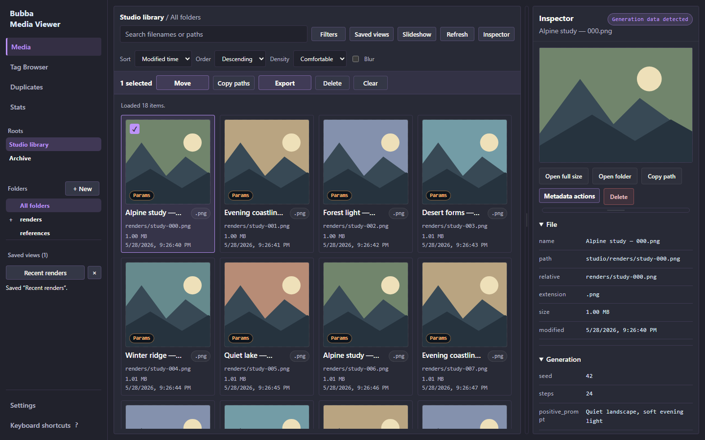

# Bubba Media Viewer

A local desktop web app for browsing image libraries, inspecting generation metadata, comparing results, and cleaning up duplicates. Your media stays on your machine.



Use the left sidebar to switch sections and browse media roots, folders, and saved views. The center holds your results; the resizable inspector shows the selected file. Designed for desktop windows at least 1024 × 768.

| Area | Features |
| --- | --- |
| Media | Search, filters, sorting, density, saved views, multi-selection, slideshow |
| Inspector | Image/video preview, file information, generation metadata, copy actions |
| Cleanup | Safe delete, folder moves, exact/near duplicate scans, comparison |
| Tags | Search names and aliases, favorites, recent tags, examples |
| Reports | Folder statistics, metadata coverage, JSON/CSV exports |

## Install

### Requirements

- Python 3.10 or newer.
- Windows is the primary target environment.
- Node.js/npm is only needed if you want to run frontend linting/formatting as a developer.

### Quick Install On Windows

Run:

```cmd
install.bat
```

If you prefer to install manually, use one of the setup flows below.

### Manual Install With PowerShell

```powershell
python -m venv .venv
.\.venv\Scripts\Activate.ps1
pip install -r requirements.txt
```

### Manual Install With cmd

```cmd
python -m venv .venv
.\.venv\Scripts\activate
pip install -r requirements.txt
```

## Configure Your Media Folders

Open `settings.json` and set `general.asset_roots` to the folders you want Bubba Media Viewer to browse.

Example:

```json
{
  "general": {
    "asset_roots": [
      "C:\\StabilityMatrix\\Data\\Images\\Text2Img"
    ]
  },
  "viewer": {
    "density": "large",
    "preview": false
  }
}
```

Only files inside configured asset roots are available to the app. If no roots are configured, the Media tab will not have a folder to browse.

You can configure multiple roots. The viewer will show them in the library sidebar so you can switch between libraries without changing code or restarting your workflow.

### Where Settings Are Stored

When running from a source checkout, the app reads and writes the repo-local `settings.json` file.

Standalone packaged builds are designed to keep user-editable state out of the install folder. In packaged mode, settings are stored at:

```text
%APPDATA%\Bubba Media Viewer\settings.json
```

Generated report caches are also stored under:

```text
%APPDATA%\Bubba Media Viewer\cache\
```

On first launch, the packaged app copies the bundled default `settings.json` into AppData if no user settings file exists yet. This means the app can be updated or replaced later without wiping your configured media folders or relying on writes to the install directory.

### Viewer Preferences

The `viewer` section controls presentation defaults:

- `density`: default media card density. Supported values are `compact`, `comfortable`, and `large`.
- `preview`: whether thumbnail blur starts enabled.

You can also edit supported settings from the Settings tab in the app.

## Start The App

### Recommended Windows Launcher

Run:

```cmd
start.bat
```

### Manual Start

```powershell
python backend/server.py
```

Then open:

```text
http://localhost:5001/
```

## Using The Viewer

### Media

Choose **Media** in the sidebar, then select a library and folder. Search filenames or paths from the toolbar; **Filters** exposes extension and metadata options. Remove individual filter labels or use **Clear filters** when a search has no matches. Sorting, density, and blur sit in the view-controls row.

Selecting media opens its information in the inspector. Use **Inspector** to hide or show it; its visibility is retained while switching sections. Drag the separator to resize it, or focus the separator and use the arrow keys. File, Generation, and Embedded metadata sections can be collapsed independently.

Selection actions appear in their own row. Ctrl-click selects individual items, Shift-click extends the selection, and **Clear** clears it. Compare requires exactly two previewable images.

Choose **Saved views** in the toolbar to name the current folder, search, filters, and sorting. Views appear under the current library in the sidebar and persist in this browser. Reusing a name replaces that view; × removes it.

Choose **Slideshow** to review currently loaded items, starting from the selected media. Previous/Next and arrow keys move through the batch; Play advances every 3, 5, or 10 seconds. Videos have playback controls. Escape closes review mode and restores focus. Load additional media first to include it in the slideshow.

Failed requests offer **Retry**. Refresh and pagination failures preserve visible media; retries continue from the last successful page.

From here you can:

- Pick the active root folder.
- Search by name/path.
- Filter by extension and metadata state.
- Sort by name, modified date, size, or metadata.
- Change card density.
- Select one or many media items.
- Copy the selected image or selected file path(s).
- Open the image full-size or open its containing folder.
- Upload images into the current root.
- Delete selected media.
- Compare two selected images.
- Repair tracked PNG metadata when available.

Deletion defaults to safe delete, which moves files to `.asset_viewer_trash` inside the asset root. Permanent delete is available through the permanent-delete shortcut or Shift-click delete actions.

### Tag Browser

The Tag Browser is a companion panel for prompt and label work. Search for a tag or alias, inspect the selected tag on the right, copy it, favorite it, or jump to an external search.

You can:

- Search tags and aliases.
- Filter by category.
- View all, favorite, or recent tags.
- Copy a selected tag.
- Favorite or unfavorite tags.
- Inspect aliases and example posts.
- Open external searches for a tag.

### Duplicates

The Duplicates tab is built for cleanup sessions. Run a scan on the current root, review grouped results, compare similar images, select everything except the keeper, then delete or export the findings.

You can:

- Run a duplicate scan for the selected root.
- Include near-duplicate detection.
- Watch scan progress.
- Cancel an active scan.
- Select all but one item from duplicate groups.
- Compare duplicate candidates.
- Delete selected duplicate media.
- Export duplicate reports as JSON or CSV.

### Stats

Use the Stats tab to understand the shape and health of a library. It can load folder statistics and metadata health reports for the selected root or all configured roots. Reports can be refreshed and exported.

### Settings

Use the Settings tab to edit supported viewer settings without opening `settings.json` manually. Changes are saved back to disk.

## Typical Workflows

### Review A New Generation Batch

1. Open the Media tab.
2. Select the output root.
3. Sort by modified date.
4. Use arrow keys to move through the newest images.
5. Copy strong candidates to the clipboard or open them full-size.
6. Delete rejects with safe delete.

### Clean Up Duplicates

1. Open the Duplicates tab.
2. Choose whether to include near duplicates.
3. Run the scan with `Ctrl+Shift+D` or the scan button.
4. Compare uncertain candidates.
5. Select duplicate items you do not want to keep.
6. Delete or export the report.

### Build Or Refine Prompt Tags

1. Open the Tag Browser.
2. Search by tag name or alias.
3. Move through results with `Up` and `Down`.
4. Copy the selected tag with `Ctrl+C`.
5. Favorite useful tags for later.

### Audit Metadata

1. Open the Stats tab.
2. Load metadata health for the current root.
3. Export the report if you want to keep a snapshot.
4. Return to Media to inspect or repair individual files.

## Keyboard Shortcuts

Shortcuts apply when focus is not inside an input, textarea, select, or editable field. Press `?` in the app to open the in-app shortcut reference.

On macOS, browser-level `Cmd` is treated like `Ctrl` for command shortcuts where supported.

### Navigation And General

| Shortcut | Function |
| --- | --- |
| `M` | Open Media tab |
| `T` | Open Tag Browser tab |
| `D` | Open Duplicates tab |
| `S` | Open Stats tab |
| `?` | Open keyboard shortcut reference |
| `Esc` | Close shortcut/delete/compare modal, or clear selection |
| `R` | Refresh Media, Tags, Stats, or Settings |
| `Ctrl+F` | Focus search in Media or Tags |
| `Ctrl+A` | Select all visible media or duplicate media |
| `Ctrl+E` | Export media selection or duplicate groups |
| `Ctrl+L` | Copy selected media or tag name |

### Media

| Shortcut | Function |
| --- | --- |
| `Arrows` | Move media selection |
| `Shift+Arrows` | Extend media selection while moving |
| `Space` | Toggle selected media into multi-selection |
| `Enter` | Open selected media full-size |
| `Ctrl+C` | Copy selected image to clipboard |
| `Ctrl+Shift+C` | Copy selected file path(s) |
| `Ctrl+O` | Open selected media full-size |
| `Ctrl+Shift+O` | Open containing folder |
| `B` | Toggle thumbnail blur |
| `Delete` | Delete selected media |
| `Shift+Delete` | Permanently delete selected media |

### Duplicates

| Shortcut | Function |
| --- | --- |
| `Arrows` | Move duplicate media selection |
| `Shift+Arrows` | Extend duplicate selection while moving |
| `Space` | Toggle selected duplicate media |
| `Ctrl+C` | Copy selected duplicate path(s) |
| `Ctrl+Shift+C` | Copy selected duplicate path(s) |
| `Ctrl+A` | Select all duplicate media |
| `Ctrl+E` | Export duplicate groups |
| `Ctrl+Shift+D` | Run duplicate scan for current root |
| `Delete` | Delete selected duplicate media |
| `Shift+Delete` | Permanently delete selected duplicate media |

### Tags

| Shortcut | Function |
| --- | --- |
| `Up / Down` | Move through tag list |
| `Enter` | Select focused tag row |
| `Space` | Select focused tag row |
| `Ctrl+C` | Copy selected tag |
| `Ctrl+Shift+F` | Favorite or unfavorite selected tag |
| `Ctrl+L` | Copy selected tag name |
| `/` | Focus tag search |

### Compare Modal

| Shortcut | Function |
| --- | --- |
| `Left / Right` | Move compare divider |
| `Shift+Left / Right` | Move compare divider faster |
| `Home` | Move divider fully left |
| `End` | Move divider fully right |
| `Esc` | Close compare modal |

## Safety Notes

- The viewer can upload, move, and delete files inside configured asset roots.
- Safe delete moves media to `.asset_viewer_trash`.
- Permanent delete bypasses the viewer trash.
- Keep `settings.json` pointed only at folders you intentionally want the app to manage.
- This app is intended for local trusted use, not public hosting.

## Troubleshooting

### The Media tab is empty

Check `settings.json` and make sure `general.asset_roots` contains at least one existing folder.

### Thumbnails do not appear

Make sure the files are supported image types and are inside a configured asset root. The app currently handles common image extensions such as PNG, JPG/JPEG, WEBP, BMP, GIF, TIF, and TIFF.

### Open containing folder does nothing

Folder opening depends on the local operating system. Windows is the primary supported environment.

### Clipboard image copy fails

Image clipboard support depends on the browser. Path and tag copying should still work even if image copying is unavailable.

## For Developers

### Project Structure

```text
backend/
  server.py                  Flask app factory and server entrypoint
  settings_model.py          Pydantic settings schema and validation
  blueprints/                HTTP route registration by feature area
  services/                  Backend services for assets, tags, settings, duplicates, metadata, thumbnails, and trash

frontend/
  asset_viewer_vue.html      Static app shell
  asset_viewer_vue.js        Vue app mount and top-level layout
  styles/                    CSS modules
  vendor/                    Vendored Vue ESM build
  vue/components/            Vue component modules
  vue/composables/           State and workflow composables

tests/                       Backend and smoke tests
```

### Development Setup

Install Python dependencies:

```powershell
pip install -r requirements-dev.txt
python -m playwright install chromium
```

Install frontend tooling:

```powershell
npm install
```

Run the backend:

```powershell
python backend/server.py
```

### Browser verification

Browser tests use a static frontend server, mocked API responses, synthetic media, and isolated browser storage. They do not access your configured asset folders. Install `requirements-dev.txt` and Chromium before running them; missing browser tooling is an error, not a skipped check.

```powershell
python -m pytest tests/test_desktop_ui.py tests/test_browser_smoke.py -q
```

Screenshots from the desktop checks are written to `build/ui-redesign/`. To keep browser downloads inside this checkout on Windows, set `$env:PLAYWRIGHT_BROWSERS_PATH = "$PWD/build/browsers"` before installing Chromium. Tests automatically use that directory if present.

### QA Commands

```powershell
python -m ruff check .
python -m mypy
python -m pytest -q
npm run lint:frontend
npm run format:frontend:check
npm run test:frontend
```

Format frontend files:

```powershell
npm run format:frontend
```

### Windows Build

Install build tooling and create a portable Windows build:

```powershell
.\scripts\build_windows.ps1
```

For a faster local packaging pass after checks already passed:

```powershell
.\scripts\build_windows.ps1 -SkipChecks
```

The build outputs:

```text
dist\BubbaMediaViewer\
dist\BubbaMediaViewer-windows-x64.zip
```

GitHub Actions runs CI checks on `develop` and `main`, and publishes release artifacts from version tags matching `v*`.

To publish a GitHub Release:

```powershell
git tag v0.1.0
git push origin v0.1.0
```

Version tags matching `v*` run the Windows build, create a GitHub Release, generate release notes, and attach `BubbaMediaViewer-windows-x64.zip` to the release.

### CI And Release Flow Quick Guide

This repo uses two workflows:

- `.github/workflows/windows-build.yml` (CI): runs backend/frontend checks on pushes to `develop` and `main`.
- `.github/workflows/windows-release.yml` (Release): runs on pushed tags matching `v*`, builds the portable zip, and publishes a GitHub Release.

Typical flow:

1. Open a feature branch from `develop`.
2. Merge feature branch into `develop` to run CI checks.
3. Merge `develop` into `main` when ready to ship.
4. Create and push a version tag on `main` to publish the release.

Example commands:

```powershell
# Start feature work from develop
git checkout develop
git pull origin develop
git checkout -b feature/my-change

# After committing, push feature branch and open PR to develop
git push -u origin feature/my-change

# After PR merge to develop, update local branches
git checkout develop
git pull origin develop
git checkout main
git pull origin main

# Merge develop into main (or use PR in GitHub)
git merge --ff-only develop
git push origin main

# Tag main for release
git tag v0.1.0
git push origin v0.1.0
```

Notes:

- Keep tags semantic, for example `v0.1.0`, `v0.1.1`, `v0.2.0`.
- Create tags from the exact `main` commit you want to release.
- Create the tag after that PR is merged into `main`.

### Maintenance Notes

- Keep Flask routes thin; route modules should validate HTTP input and delegate behavior to `backend/services/`.
- Keep Vue components focused on rendering and user events; shared state/workflows belong in composables.
- Keep runtime path decisions in `backend/runtime_paths.py`; packaged builds should write mutable state to AppData, not the install directory.
- Update both the in-app shortcut modal and this README when adding or changing shortcuts.
- Update `backend/settings_model.py` when adding persisted settings.
- Avoid committing local caches, generated thumbnails, `.asset_viewer_trash`, virtualenvs, or `node_modules`.

## License

See [LICENSE](LICENSE).
